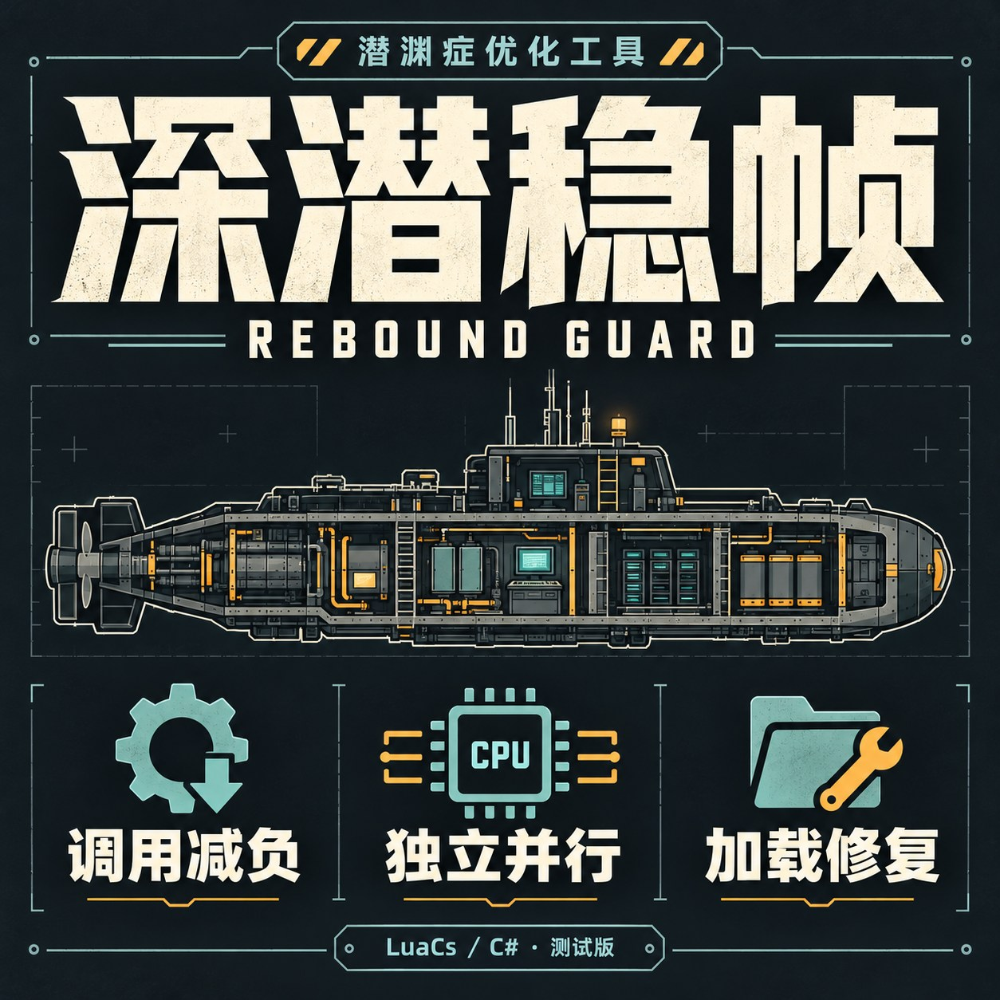

# Rebound Guard / 深潜稳帧

Experimental Barotrauma performance utilities and lifetime fixes. [中文说明](README.zh-CN.md) · [Steam Workshop](https://steamcommunity.com/sharedfiles/filedetails/?id=3822098302) · [Development handoff](docs/HANDOFF.md)

Current gameplay code: **0.4.0**, verified on Windows, Barotrauma **1.13.4.0**, with matching LuaCs/C# method builds.

The common patch reduces empty LuaCs callback-phase work and repeated method metadata/result wrapping, adds conservative query/queue indexes and independent-stage parallel work, and fixes audited reference-enumerator and shutdown lifetime defects. Actual callbacks and simulation rules remain. Default physics, AI and effect frequencies are unchanged.

Install compatible [LuaCsForBarotrauma](https://steamcommunity.com/sharedfiles/filedetails/?id=2559634234), enable C# scripting, subscribe/enable this mod, disable older Rebound Guard builds, and fully restart. Load it on the actual server process and each client wanting local benefits. See the Chinese guide for manual installation, optional source-audited rule ports, diagnostics and rollback.

Local real-LuaCs wrapper tests allocated about 57% less for 20k calls; a reproduced early-ended-enumeration unload wait dropped from about two seconds to milliseconds. These do **not** establish whole-game FPS, loading-time or universal rubberbanding/desync/crash improvements. No live multiplayer A/B was run for 0.4.0. Unsupported code or competing patches cause affected features to fall back.

Source: `LocalMod/ReboundGuard`; tests/tooling: `tests`, `tools`; public Workshop assets and localized copy: `workshop`. Native game/runtime dependencies are not distributed through the public repository. See `docs/HANDOFF.md` for verification commands, source fingerprints, state-equivalence checks and remaining investigations. Private field evidence and migration-only runtimes are excluded.

Cover artwork was generated with the built-in image_gen tool; final prompt is stored with the Workshop assets.
